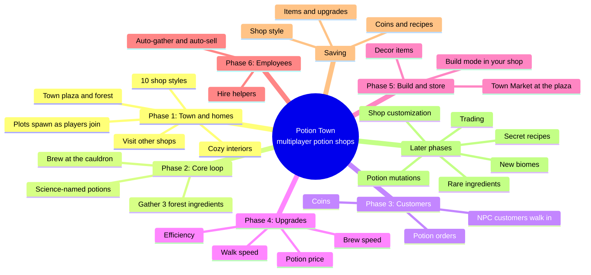

# Potion Town: Game Design

A cozy multiplayer potion shop game for Roblox. Every player runs their own magical
potion shop in a shared town. They gather ingredients in the enchanted forest, brew
potions named after real science molecules, sell them to NPC customers, and spend
their coins on upgrades, decor and employees. They can also visit and admire each
other's shops.

**Look and feel:** warm candlelight, glowing bottles on crowded wooden shelves, a
bubbling cauldron, hanging herbs and lanterns, golden-hour light with soft fog.

## Mind map

## Phases

| Phase | Name | What gets built | Status |
|---|---|---|---|
| 1 | **Town and homes** | Town map, plots that are handed out as players join, 10 shop styles, style picker, Visit/Home/Town travel, interactive door, cauldron and shop sign, sparkles | ✅ Built |
| 2 | Core loop | 3 gatherable forest ingredients, inventory, brewing at the cauldron, recipe book | Planned |
| 3 | Customers | NPCs walk to your counter and order a potion. You get coins when you deliver it. | Planned |
| 4 | Upgrades | Power-ups for walk speed, brew speed, potion sell price and gather efficiency | Planned |
| 5 | Build and store | Build mode to place furniture in your shop. The Town Market in the plaza sells special decor that you can't make in build mode. | Planned |
| 6 | Employees | Hire helpers who gather, brew or serve customers for you | Planned |
| — | Saving | Grows every phase. Phase 1 already saves your style and sparkles. | Ongoing |
| Later | Expansions | Rare ingredients, secret recipes, mutations, trading, new biomes, more customization | Ideas |

## Phase 1 details (built)

- **Town layout:** a central plaza holds the **Town Market** pavilion (the future
  store from Phase 5), a giant bubbling cauldron, lamp posts, flower beds and a
  wishing well. Eight plots ring the plaza and each one has a cobblestone path back
  to it. Past the plots lies an enchanted forest with trees, magic purple and teal
  trees, glowing mushrooms, fireflies and a pond.
- **Plots:** when a player joins they claim the next free plot and their shop is
  built there. When they leave, the shop disappears and an "Empty Plot" sign returns.
- **Spawning:** you spawn inside your own shop, just behind the door.
- **10 shop styles:**

  | | Style | Vibe |
  |---|---|---|
  | 🧙 | Enchanted Cottage | Witchy wood, shingles, smoking chimney (the default, matches the reference art) |
  | 🚀 | Futuristic Lab | White panels, neon strips, chrome dome, antenna |
  | 🎀 | Coquette Boutique | Pastel pink, striped awning, bows, flower boxes |
  | 🌾 | Rustic Farmhouse | White boards, barn-red trim, picket fence, hay bales |
  | 🌲 | Wooden Lodge | Log-cabin corners, steep roof, chimney |
  | 🏰 | Gothic Castle | Stone, 4 corner towers, battlements, purple windows |
  | 🍄 | Mushroom Hideaway | Giant spotted mushroom cap, glowing mini shrooms |
  | ⛩️ | Zen Tea House | 3-tier pagoda roof, red paper lanterns |
  | 💎 | Crystal Spire | Ice walls, glass spire, glowing crystal clusters |
  | 🏜️ | Sunstone Bazaar | Sandstone, teal dome, striped awning, clay pots |

- **Every interior** has shelves of glowing potion bottles, a bubbling cauldron over
  a fire, a shop counter with a till, bell and candle, barrels, ceiling beams, drying
  herbs and hanging lanterns.
- **Interactions:**
  - The door opens and closes for anyone.
  - Stir the cauldron to make it bubble a new color.
  - The shop sign shows **Leave a Sparkle ✨** to visitors (it's a like and counts
    toward the shop's total). The owner sees **Change Shop Style** instead.
  - Make a wish at the wishing well to get a fortune.
  - Browse the market stalls (a "coming soon" message for now).
- **UI:** a side menu with 🏠 Home, 🎨 Style, 🧭 Visit (lists every other player's
  shop) and ⛲ Town, plus toast messages. First-time players get a welcome style picker.

## Potion science (draft for Phase 2)

Every potion is named after a real molecule and does several things at once. In the
first version the forest has three ingredients:

| Ingredient | Where | Real-science idea |
|---|---|---|
| 🍄 Glowcap Mushroom | Under trees, glows at dusk | Contains **luciferin**, the molecule that makes fireflies glow |
| 🌿 Silverleaf Fern | Forest floor | Full of **chlorophyll** |
| 💎 Sparkwater Crystal | By the pond | A mineral salt (**sodium chloride**) |

Recipes are 2 ingredients, or all 3:

| Recipe | Potion | Effects (a group of things) | Base price |
|---|---|---|---|
| 🍄 + 🍄 | **Luciferin Glow Elixir** | You glow, see better at night, and it shows hidden ingredients | 10 |
| 🌿 + 🌿 | **Chlorophyll Tonic** | Plants regrow faster, gives a small heal, turns you slightly green | 10 |
| 💎 + 💎 | **Electrolyte Surge** | More stamina, faster gathering | 12 |
| 🍄 + 🌿 | **Melatonin Mist** | Calms customers so they wait longer, slows time, makes you sleepy | 18 |
| 🍄 + 💎 | **Adrenaline Rush** (epinephrine) | Faster run, higher jump, faster brewing | 20 |
| 🌿 + 💎 | **Serotonin Spritz** | Happy customers who tip more, plus confetti | 22 |
| 🍄 + 🌿 + 💎 | **Dopamine Delight** | All of the above for a short time, sells high | 40 |

Ideas for secret or rare recipes later: **Oxytocin Elixir** (friendship, trading
bonus), **Hemoglobin Draught** (healing), **Endorphin Boost**, **Caffeine
Concentrate**, **Collagen Cream**, **Insulin Balance**. A mutation could randomly
upgrade a potion to a "Pure" or "Unstable" version.

## Open questions for later phases

1. **Coin name.** Plain "coins", or something themed like "Sparkle Shards"?
2. **Offline shops.** Right now a shop only exists while its owner is in the server.
   Should players be able to visit shops of people who are offline (harder to build)?
3. **Server size.** The town has 8 plots, so set Max Players to 8. Bigger towns are
   possible later.
4. **Main devices.** Phone, PC or both? This decides how big the buttons should be.
